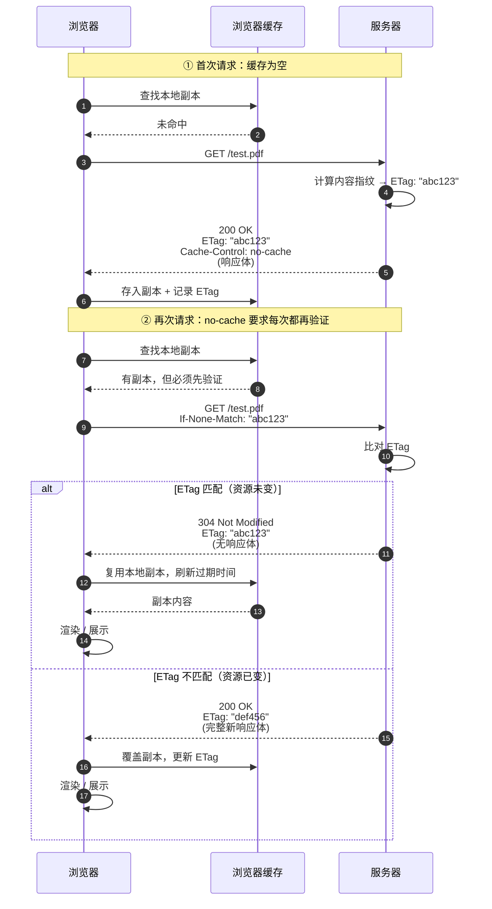

ETag 是 HTTP 协商缓存的核心：服务器给资源算一个指纹，客户端下次请求时原样带回，服务端比对相同就只回 304，省下一次响应体的传输。

<!-- more -->

## 一次完整的协商过程



## 一个能跑的 Node 实现

```javascript
const http = require("http")
const fs = require("fs")
const crypto = require("crypto")

// 启动时算一次即可：文件不变，指纹就不变
// 注意 ETag 值必须带双引号，这是 RFC 9110 的语法要求
const pdf = fs.readFileSync("./test.pdf")
const etag = `"${crypto.createHash("md5").update(pdf).digest("hex")}"`

const server = http.createServer((req, res) => {
  if (req.url !== "/test.pdf") {
    res.statusCode = 404
    res.end()
    return
  }

  // 无论 200 还是 304 都要带上 ETag 与缓存策略
  res.setHeader("ETag", etag)
  res.setHeader("Content-Type", "application/pdf")
  res.setHeader("Cache-Control", "no-cache")

  // If-None-Match 可能是逗号分隔的列表，逐个比较
  const inm = (req.headers["if-none-match"] || "")
    .split(",")
    .map((v) => v.trim())

  if (inm.includes(etag)) {
    res.statusCode = 304
    res.end() // 304 没有响应体
    return
  }

  res.statusCode = 200
  res.end(pdf)
})

server.listen(3000, () => {
  console.log("Server is listening on http://localhost:3000")
})
```

## 几个容易踩的点

### ETag 值必须带双引号

这是最容易静默失效的一条。如果服务端发的是裸的 `7d3f...`，浏览器回传时**自己加上引号**变成 `"7d3f..."`，而你的代码比的是裸值，两者永远不相等 —— 每次都是 200，缓存等于没配。

```text
服务端发:      ETag: 7d3f2a...
浏览器回传:    If-None-Match: "7d3f2a..."   ← 多了引号
裸值比较结果:  不匹配 → 每次都回 200
```

按规范发 `ETag: "7d3f2a..."`（引号是值的一部分），两边就一致了。

### 304 也要带 ETag

很多人只想着 200 路径设头。304 少带 `ETag` 会让客户端丢掉指纹，某些实现在下一轮就退回 200 全量下载。`ETag`、`Cache-Control` 这类元数据在 304 上同样有意义。

### 路径不匹配时要给响应

如果只写 `if (url === "/test.pdf") { ... }` 而没有 else，任何其他路径的请求都会挂在那里直到客户端超时，这是排查时最难看出的一种"卡住"。

### 别在请求里重新读文件算哈希

`fs.readFileSync` + `createHash` 放在请求处理函数里，等于每次请求都同步读全量文件、阻塞事件循环，大文件直接卡死。文件内容不变时指纹就不变，启动时算一次（或用 `fs.watch` 更新）即可。

### 304 只省带宽，不省往返

304 仍然是一次完整的网络往返。想省掉往返要靠 `Cache-Control: max-age` 的强缓存；ETag 管的是"发了请求之后要不要回包"。

### 弱 ETag 与 If-Modified-Since

- 弱 ETag（`W/"abc123"`）只保证语义等价，用于压缩或格式转换后仍视为同一资源；`If-None-Match` 的默认比较走弱比较。
- 没有 ETag 时可用 `If-Modified-Since` 兜底，但时间精度只到秒，容易误判，通常两者配合使用。

## 小结

ETag 用内容指纹换取带宽，`If-None-Match` 与 304 是它成对出现的两端；强缓存管"要不要发请求"，协商缓存管"发了请求要不要回包"。实现在语法上有两处硬要求：值必须带双引号、304 也必须回带元数据。
