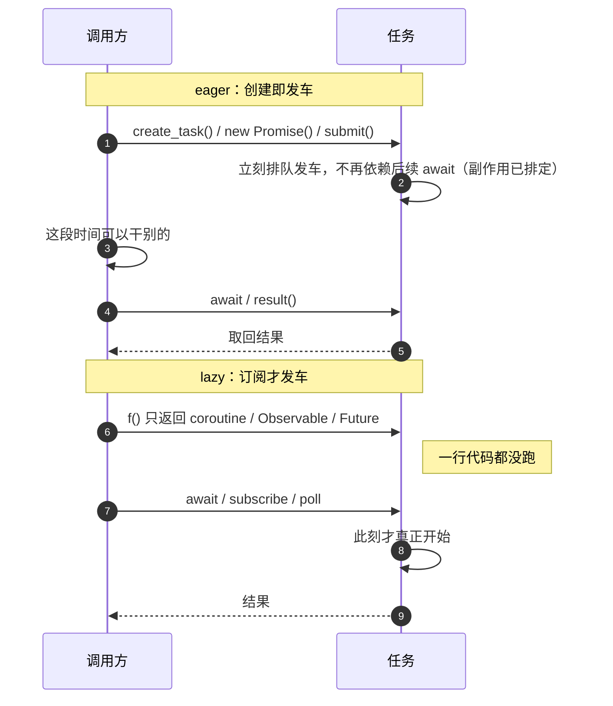

异步要解决的从来不是"算得更快"，而是"等在 I/O 上时不白占着执行资源"。实现上通常走两条路：多线程把等待分摊给多个执行体，事件循环把等待登记给内核；而任务究竟在创建那一刻就发车，还是等到被 await / 订阅才发车，是与之完全正交的另一个维度（eager / lazy）。很多"我明明写了异步，怎么还是串行"的问题，根子都在第二个维度上。

<!-- more -->

## 两条实现路线

### 多线程：让阻塞留在自己的线程里

最直觉的做法：一个并发任务配一个执行体，代码照着同步顺序写，遇到 `read()`、`recv()` 就原地阻塞。挂起和唤醒由操作系统调度器负责，某个线程在等磁盘，别的线程照常跑。

```python
from concurrent.futures import ThreadPoolExecutor
import urllib.request

def fetch(url):
    # 阻塞的是这个工作线程，主线程不受影响
    return urllib.request.urlopen(url).read()

with ThreadPoolExecutor(max_workers=8) as pool:
    futures = [pool.submit(fetch, u) for u in urls]  # submit 即发车
    bodies = [f.result() for f in futures]
```

- **优点**：写法是同步的，心智负担低；天然吃多核，CPU 密集型任务能真并行；任何阻塞式库（DNS、文件系统、老数据库驱动）都能直接用，不需要改造。
- **代价**：每个线程带着自己的栈（默认按 MB 计），几千个连接就是实打实的内存和上下文切换开销；共享可变状态要加锁，竞态、死锁、取消和异常传播都变难。并发度的上限，本质上被"能开多少线程"锁死。

### 事件循环：把等待交给内核

另一种思路是只用一个（或少数几个）线程，跑一个循环：把 fd 和关心的事件注册给 `epoll` / `kqueue` / IOCP / `io_uring`，内核说哪个就绪，就取出对应的回调执行。回调之间不会互相阻塞，因为没人真的在 I/O 上睡着。

```javascript
// Node 里没有任何一行代码在"等"网络，等在 libuv 那边
const res = await fetch("https://example.com")
```

- **优点**：连接数可以很大而内存很省；单线程里没有共享状态的锁问题，切换成本也低。I/O 密集场景伸缩性最好。
- **代价**：回调里**不能阻塞、不能长算**，一个 200ms 的同步计算就让整个循环上的所有请求一起卡住（队头阻塞）；CPU 密集活得丢给 worker。还有"异步传染性"：一旦某层是异步的，调用链上层往往也得跟着异步（所谓 function coloring），错误栈也不再直观。

### 别把二分法当教条

现实中的运行时几乎都是混合体，区分"**写起来的样子**"和"**底下的机制**"很重要：

- Node.js：网络 I/O 走事件循环，但 `fs`、`DNS`、`crypto` 这类难以非阻塞化的操作由 libuv 的小线程池承接。
- Go：代码是 `go f()` 的阻塞式写法，运行时却用 netpoller 把网络等待挂到事件通知上，阻塞的 goroutine 会被换下 M。
- Rust tokio：多线程 scheduler 上做 work-stealing，`async fn` 是惰性 Future，但执行可以分布在多个 worker 线程上。

所以"多线程 vs 事件循环"描述的是**等待由谁承担**，"同步写法 vs async/await"描述的是**代码长什么样**，两者不必一致。

## 启动时机：eager 与 lazy



### eager：创建即发车

拿到的是一个**凭证**（Future / Promise / Task / 句柄），工作已经在路上了，后面的 `await` 只是"等 + 取值"，不是"启动"。

```javascript
const p = new Promise((resolve) => {
  console.log("① executor 在构造时同步执行")  // 不等 await 就打印
  setTimeout(() => resolve(42), 1000)
})
console.log("② 还没 await，请求/定时器已经发出去了")
await p
```

同类的还有 `fetch()`、`pool.submit()`、`Thread.start()`、`asyncio.create_task()`、`tokio::spawn()`、`go f()`、`CompletableFuture.supplyAsync()`。精确的边界是：`create_task()` 是**立刻排进就绪队列**，函数体第一行要等当前协程把控制权交回循环才执行，但调度决定已经做出，跟你后续 await 不 await 无关。

eager 的隐含后果：并发是默认状态；副作用发生得早；**丢掉句柄通常不等于取消**（JS 的 Promise 压根不可取消），而且没人接住的失败会冒到全局（`unhandledRejection`、Python 的 "Task exception was never retrieved"）。

### lazy：创建只是写好菜谱

拿到的是一个**描述**，什么都没发生；只有终端操作（await / subscribe / collect / poll）才推进它，并且通常是 **cold** 的：每次订阅都重新执行一遍。

```python
import asyncio

async def work(name):
    print(f"{name} 开始")          # 真正被调度才打印
    await asyncio.sleep(1)
    return name

async def main():
    a = work("A")                  # lazy：只有 coroutine 对象，一行都没跑
    b = work("B")
    print("两个协程都创建了，但没打印任何 '开始'")
    await asyncio.gather(a, b)     # 此刻才一起启动 → 总共约 1 秒

    t = asyncio.create_task(work("C"))   # eager：立刻排进就绪队列
    print("C 的调度已定，交回控制权就开跑，与何时 await 无关")
    await t

asyncio.run(main())
```

同类还有 Rust 的 `async fn`（不 `poll` 就不推进）、RxJS 的 cold `Observable`、Kotlin `Flow`（`collect` 才发射）、Java `Stream`、函数式的 `IO`。

lazy 的好处是可组合、可重放、可重试、好做超时与背压；没订阅就是零成本取消，副作用不会偷偷发生。代价是"以为起了两个任务其实一个都没起"，以及默认串行。

> 顺带区分 **cold / hot**：cold 是"没人订阅就不生产"，hot（RxJS `Subject`、Kotlin `SharedFlow`、DOM 事件）则是无论有没有人听都在产生数据。lazy 一般是 cold，但 hot 流也可以是 eager 的，这是两个不同的说法。

### 怎么快速判断手上的东西是哪一种

1. 在创建之后、await 之前加一行日志或看一眼网络面板：有输出/有请求 = eager。
2. 看 API 动词：`start` / `submit` / `spawn` / `create_task` / `go` 基本都是 eager；返回 `coroutine` / `Future` / `Flow` / `Observable` 的构造基本都是 lazy。
3. 看能否被消费两次：能重复订阅的大概率是 cold/lazy；只能 await 一次（Python coroutine、Rust Future、JS Promise）是"一次性凭证/描述"，单凭这一点**判断不了** eager 还是 lazy——这正好说明要按 1、2 两条实测，别猜。

> 还有个命名陷阱：JS `Promise`、Python `Future`/`Task` 是创建即发车的凭证；Rust `Future` 是惰性的状态机；Java `Future` 只是 `submit()` 之后拿到的取结果句柄。同一个词在不同语言里指的是不同东西。

## 两个维度是正交的

|  | 多线程 | 事件循环 |
| --- | --- | --- |
| **eager** | `Thread.start()`、`pool.submit()`、Go `go f()`、`CompletableFuture.supplyAsync()` | JS `fetch` / Promise、Python `asyncio.create_task()`、`tokio::spawn()` |
| **lazy** | Java `Stream.parallel()`、RxJava cold `Observable` + `subscribeOn()`、Spark RDD | Python 裸 coroutine、Rust 未 poll 的 Future、RxJS cold Observable、Kotlin Flow |

右上角最熟悉（`fetch()` 一调用请求就出去了）；右下角是"写了 `async fn` 却什么都没发生"的常见来源；左下角最容易被忽略，它说明**惰性的是启动时机，多线程的是执行位置**——描述先构造好，终端操作（`collect` / `subscribe` / `count`）触发时，工作才被丢进线程池并行跑。tokio 的多线程 runtime 则同时踩在两格之间：Future 依然惰性，但 poll 它的线程不止一个。

## 由此产生的几个常见坑

### 以为并发了，其实是串行

```javascript
// 串行：第二个 fetch 压根还没被调用，耗时 t1 + t2
const a = await fetch(urlA)
const b = await fetch(urlB)

// 并发：两个请求都在 await 之前发出，耗时 max(t1, t2)
const [a, b] = await Promise.all([fetch(urlA), fetch(urlB)])
```

注意原因：eager 模型里串行的根源是**你没创建第二个任务**，不是 `await` 让任务变慢。lazy 模型同理——`await f(); await g()` 是两段顺序订阅，要写成 `asyncio.gather(f(), g())` / `join!(a, b)` 或先全部 `create_task` / `spawn` 才并发。**规律是：先把所有任务"发车"，再统一等待结果。**

### 以为没开始，其实请求已经发了

eager 的副作用在构造点就发生。写日志、扣额度、POST 下单这类操作，如果放在 `new Promise(...)` 或 `CompletableFuture.supplyAsync(...)` 里，那么即使调用方后来走了别的分支、再也没取结果，动作也照做不误。要取消得靠 `AbortController`、Python `Task.cancel()` 之类的显式机制，而不是"不 await 它"。

### 订阅两次 = 执行两次

cold 流每次订阅都重跑，一个 `Observable` 被两个组件订阅就可能发两次 HTTP 请求。需要共享结果时用 `share()` / `shareReplay()`、`SharedFlow` 或先把结果缓存成 hot 的 Promise/Task。反过来，Python coroutine 对象和 Rust Future 都只能消费一次，await 两遍会直接报错。

### 没人接住的异常

eager 任务失败时如果没有任何 `await` / `catch` / `result()` 去接，异常会以全局警告的形式冒出来（浏览器 `unhandledrejection`、Node 的进程级事件、asyncio 的 "never retrieved"）。创建即发车的代码要养成"创建时就挂上错误处理"的习惯，别把 Future 丢在那儿不管。

### 用错了模型的短板

事件循环里跑 CPU 密集计算，会把同进程所有请求一起拖慢，得丢给 `worker_threads`、`run_in_executor()` 或 `spawn_blocking()`；多线程里共享可变字典，则会换来锁和偶发竞态，优先用消息传递或不可变数据。这两条本质上都是"发现当前模型不擅长，就借另一条路补上"，也再次说明二分法不是非此即彼。

## 小结

一句话记：**多线程 / 事件循环决定"等待期间谁在扛"，eager / lazy 决定"什么时候发车"**。前者影响伸缩性和能不能吃多核，后者影响副作用、取消、异常处理，以及最常被问到的那个问题——"我的两个任务到底有没有同时跑"。判断并发时别只盯着 `async` 关键字，先看任务是在哪一行被创建、又是在哪一行真正启动的。
